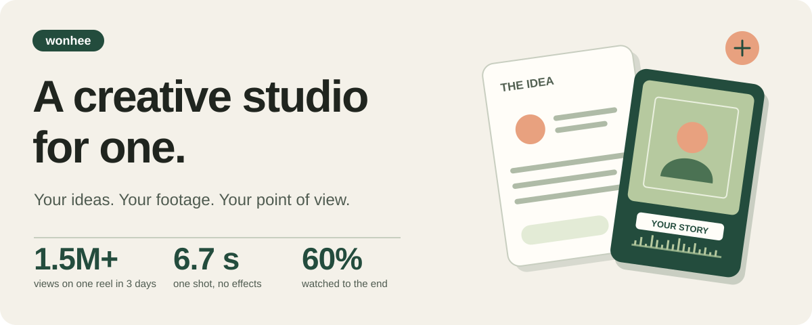
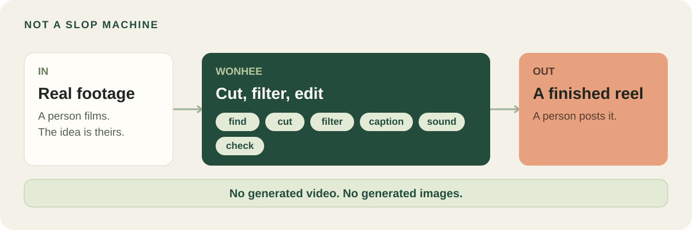
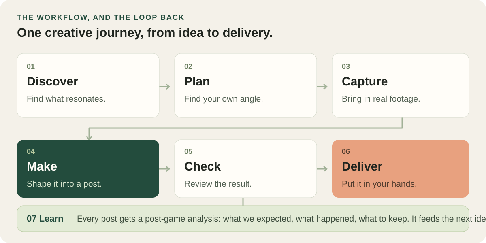
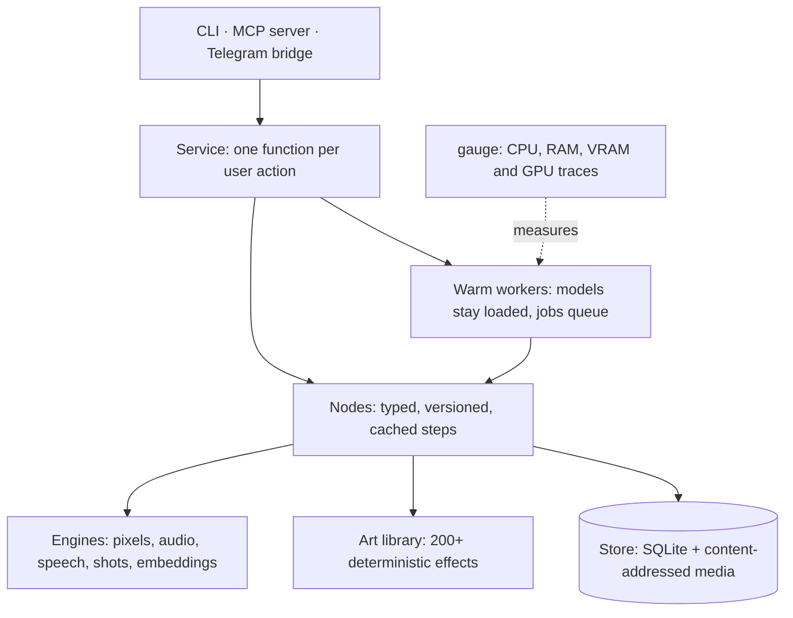

# wonhee

**A content studio for one.**

[The vision](docs/VISION.md) · [What’s built](docs/DESIGN.md) · [Setup & usage](docs/USAGE.md) · [The art library](docs/ART.md) · [Tools index](docs/TOOLS.md) · [For agents](AGENTS.md)

What if the boring part of content creation ran itself?

The research. The footage you forgot you shot. The cut, the captions, the sound, the second round of fixes.
What would a creator do with those hours? And after you post, what did the numbers say, and what should the
next one be?

## Not a slop machine

wonhee does not generate videos. A person films. wonhee finds the clip, cuts it, filters it, captions it,
fixes the sound and checks the result. The footage is real, the idea is the creator’s, and a person presses
post.

Posts made this way reach people organically. They get watched to the end, liked and sent to friends, and
some have passed a million views. Which raises the questions we care about:

- What is the least you can edit and still get watched to the end?
- Can a reference teach you something without becoming a copy?
- Does every post make the next one cheaper?
- Can one person publish like a team without working like one?

## The workflow

**discover → plan → capture → make → check → deliver → learn.** A reference shapes an original idea, a plan
guides the shoot, footage flows into the edit, and every post gets a written post-game analysis that feeds
the next idea.

## What it does

| You need to… | wonhee… |
|---|---|
| **Find an idea** | Studies posts that work, surfaces patterns, and turns a brief into ideas and shot lists saved with their references. |
| **Find that one clip** | Imports Drive footage, indexes it, and searches shots by description. |
| **Cut the reel** | Builds styled reels with timed captions, animated text and photo insets, plus montages with transitions and synthesized sound. |
| **Fake a green screen** | Keys out a plain wall by detecting the backdrop colour, with a person mask that protects a white shirt. |
| **Match your photos** | Applies or develops looks, adjusts colour, and composes posters, carousels and collages. |
| **Fix sound and subtitles** | Transcribes, translates, denoises and balances loudness. |
| **Make a backdrop** | About 200 deterministic [image effects](docs/ART.md): seeded code with palettes, so the same input gives the same picture. |
| **Show off code** | Turns repos and history into visuals, and records terminal skits and app demos in offline containers. |
| **Read the results** | Stores any public reel by URL with its metrics and analysis (speech, shots, on-screen text, look). See the [tools index](docs/TOOLS.md). |

## How it’s built

Design work sits under the reels. A written [vision](docs/VISION.md) says what it is for. A
[design](docs/DESIGN.md) sets the contracts every area has to meet and keeps a register of where code and
design disagree. Changes move through [S, M and L lanes](docs/PROCESS.md) by size.

- **Typed, cached steps.** Every capability is a node with declared inputs, outputs and parameters. Results
  are cached by node, version, inputs, parameters and model, so a repeat is free and a changed step reruns
  only itself.
- **Warm workers.** One long-lived process per lane keeps models loaded and runs detached chains from a job
  queue. The GPU is shared between agent sessions, so it goes through a lock.
- **Measured.** `gauge` runs any job in a container and records CPU, RAM, VRAM and the GPU trace. The numbers
  in the docs come from the real machine ([profiling guide](docs/profiling/GUIDE.md)).
- **Spend has a ceiling.** Paid calls run under a budget and every run reports its cost.
- **People and agents get the same tools.** Every action has a CLI command and an MCP tool with the same
  abilities. The Telegram bridge reads a [versioned contract](docs/specs/2026-11-03-bridge-contract.md), so a
  change on either side is reported instead of failing quietly.

## Principles

- Real footage in, original work out. No generated video, no generated images.
- References inform. They are never copied.
- A person posts.
- Media work stays on the machine unless a step needs an outside service.

## Status

Research, planning, editing, art and import tools are in daily use, and the Telegram bridge has delivered an
original video to a phone. In progress: one reel workflow from timeline to checks to phone delivery, style
memory for caption and cut rhythm, a director that turns an idea inbox into shoot plans, and the art library
for motion.
