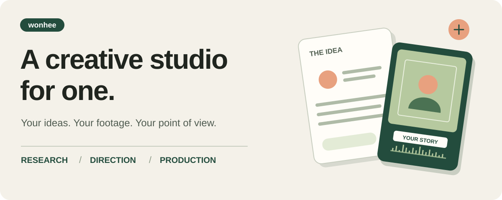
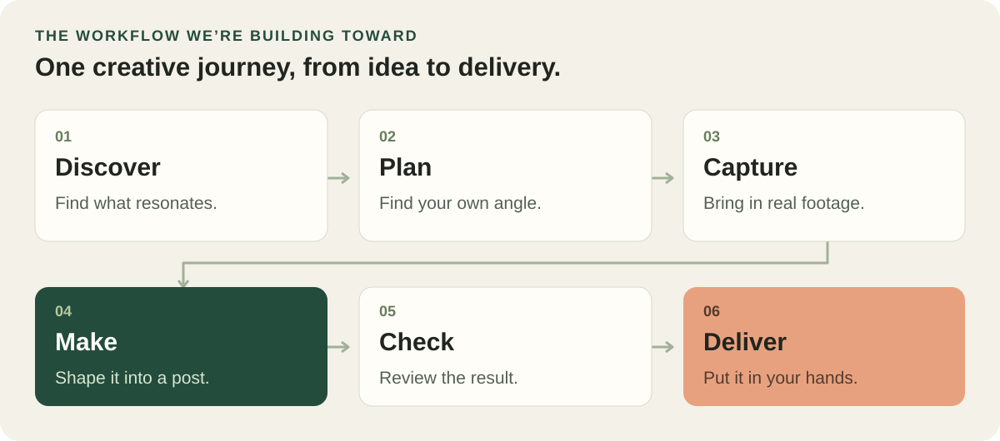

# wonhee

**An AI production studio for one creator.**

From “what should I post?” to something worth sharing.

[The vision](docs/VISION.md) · [What’s built](docs/DESIGN.md) · [Setup & usage](docs/USAGE.md)

Making a post involves a lot more than pressing record. There is the idea, the research, the footage you
forgot you shot, the edit, the captions, the sound, and the next round of changes. For a solo creator,
every handoff lands back on the same person.

**wonhee brings that work into one creative pipeline.** It combines research, planning and media tools
with AI assistants that can carry out the work. The goal is to give one person the support of a small
production team, while keeping their taste and creative direction at the centre.

## What wonhee brings to the studio

| The creative challenge | What wonhee can do today |
|---|---|
| **“I have no idea what to make.”** | Study relevant posts, surface patterns, and turn a brief or reference into ideas and shot lists. |
| **“The clip I need is somewhere in my footage.”** | Import public Google Drive files and folders, index footage, and search shots by description. |
| **“I shot it. Now comes the editing.”** | Build styled reels with timed captions, animated text, photo insets and optional pause trimming. |
| **“These photos need to feel like they belong together.”** | Apply or develop photo looks, adjust colour, and compose posters, carousels and collages. |
| **“The sound and subtitles need work.”** | Transcribe speech, translate subtitles, reduce noise and balance loudness. |
| **“My work is code or data. How do I show it?”** | Turn repository structure, project history and other data into visuals and credited card sets. |

Projects can also keep ideas, preferences and feedback together, so a creative assistant can pick up
an ongoing project with its context intact.

## The bigger picture

The ambition is one connected journey: **discover → plan → capture → make → check → deliver.**
A reference should help shape an original idea. A plan should guide the shoot. The footage should flow
into an edit, and feedback should inform the next version.

That is the direction of the project. Today, many of the research, planning, editing and import tools
are built. The next priority is to connect reel editing, comprehensive output checks and phone delivery
into a complete workflow. The Telegram integration is deployed, with an original video successfully
delivered and played back on a phone; the full edited-reel round trip still needs live validation.

## Built around the creator

**Your footage and your point of view.** Photo and video edits work with real captured media. References
help explore a direction while the result stays original.

**Conversation backed by tools.** In the current Telegram setup, moeka is the conversational front door
and wonny is the dedicated creative assistant. Wonhee provides the media workspace and production tools
behind them. Other AI assistants can connect through MCP, a standard way for assistants to use tools.

**Local work where it makes sense.** Media processing runs on the machine. Research and some AI tasks can
use external services, with spending limits on paid production runs.

**You decide what goes out.** Wonhee prepares files for you to review and share. Social posting stays
with the creator.

## Where it’s headed

- **A complete reel workflow:** an integrated editing timeline, full file checks, and phone inbox and outbox.
- **A more personal creative voice:** style memory for the rhythm of captions and cuts.
- **More help before the shoot:** a director that turns an idea inbox into plans, plus small prop projects for skits.

Wonhee is an actively developed personal production system. Its aim is practical: give a solo creator
more room to make things by taking on the work that surrounds making them.

---

For a closer look: [product vision](docs/VISION.md), [capabilities and roadmap](docs/DESIGN.md),
[reel styles](docs/production/reels.md), [photo looks](docs/production/photo-looks.md),
and [Telegram workspace](docs/production/telegram-creative.md).

For builders: [setup and commands](docs/USAGE.md) · [contributing guide](AGENTS.md) ·
[system design](docs/DESIGN.md).
